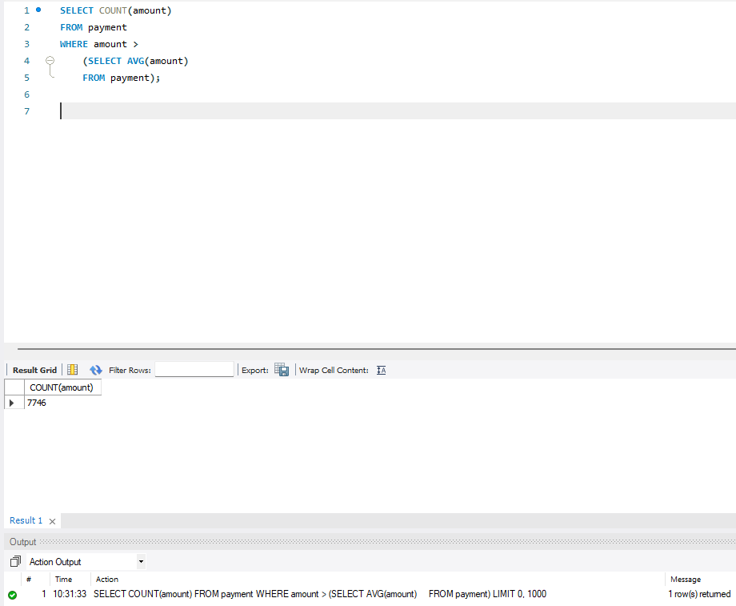
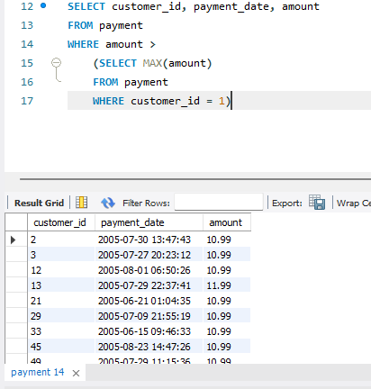
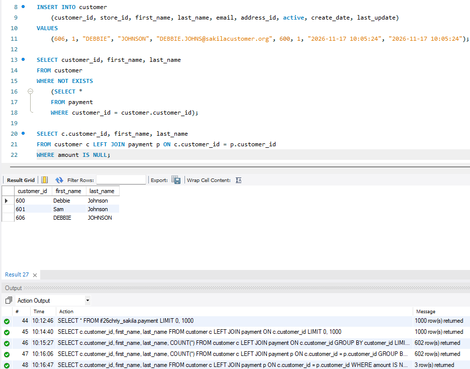

# MySQL_Chapter7

<b>Table of Content</b>
- [Summary](#summary)
- [Workers](#workers)
- [New Concepts Used](#new-concepts-used)
- [Browser Output Example](#browser-output-example)
  - [Query 1](#query-1)
  - [Query 2](#query-2)
  - [Query 3](#query-3)
  - [Query 4](#query-4)

## Summary
This is a list of exercises, the code done to use them, and the results of that code and its product.

## Workers
[@28cyager](https://github.com/28cyager) Christian Yager

## New Concepts Used
- DELETE
- INSERT
- CREATE
- DROP
- SET
- UPDATE
- CHECKSUM

## Browser Output Example
##Query 1

##Query 2

##Query 3

##Query 4

##Query 5

##Query 6

##Query 7

##Query 8

[Back to Top](#single-query)
# Chapter7_Subqueries
