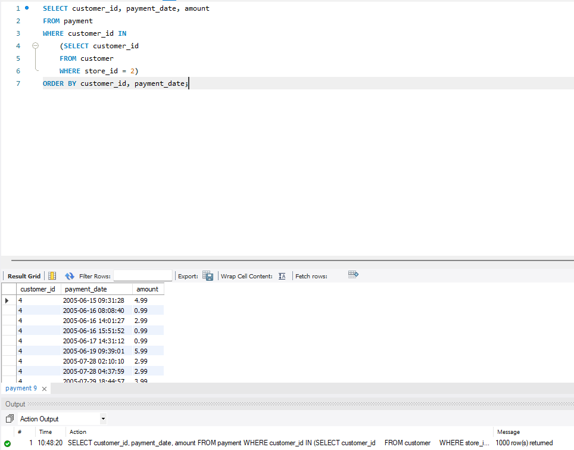
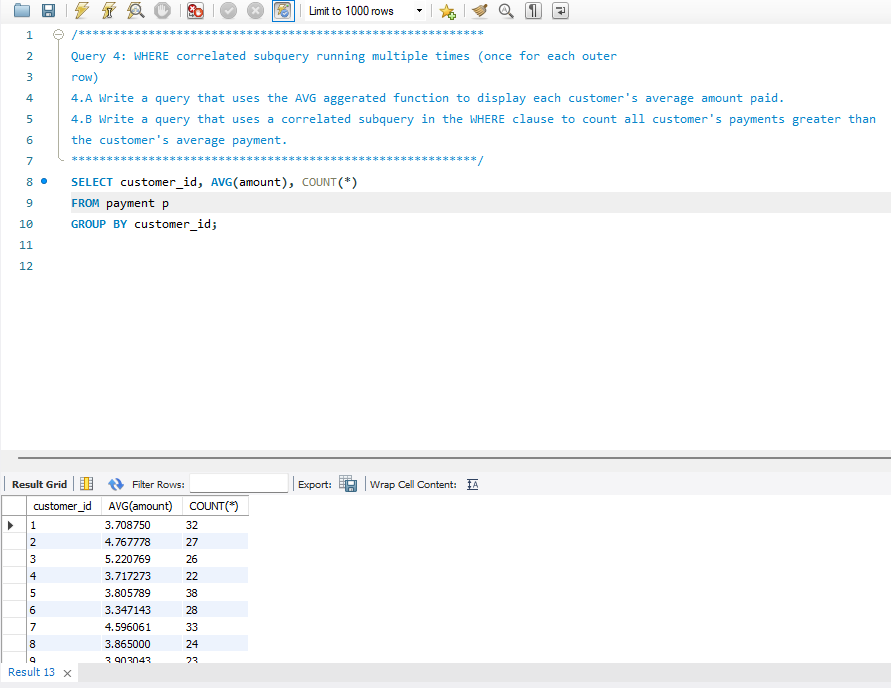
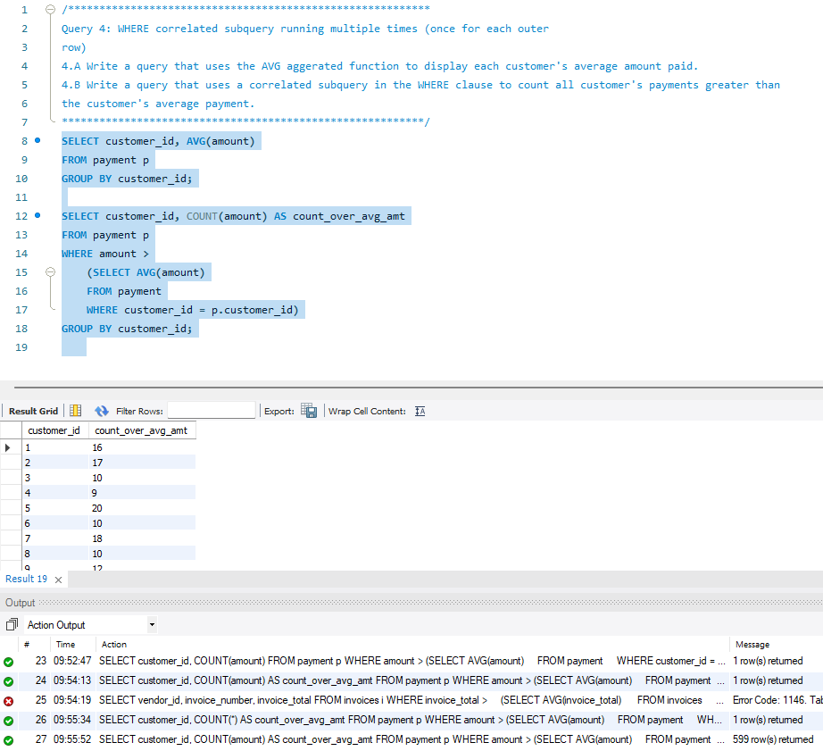
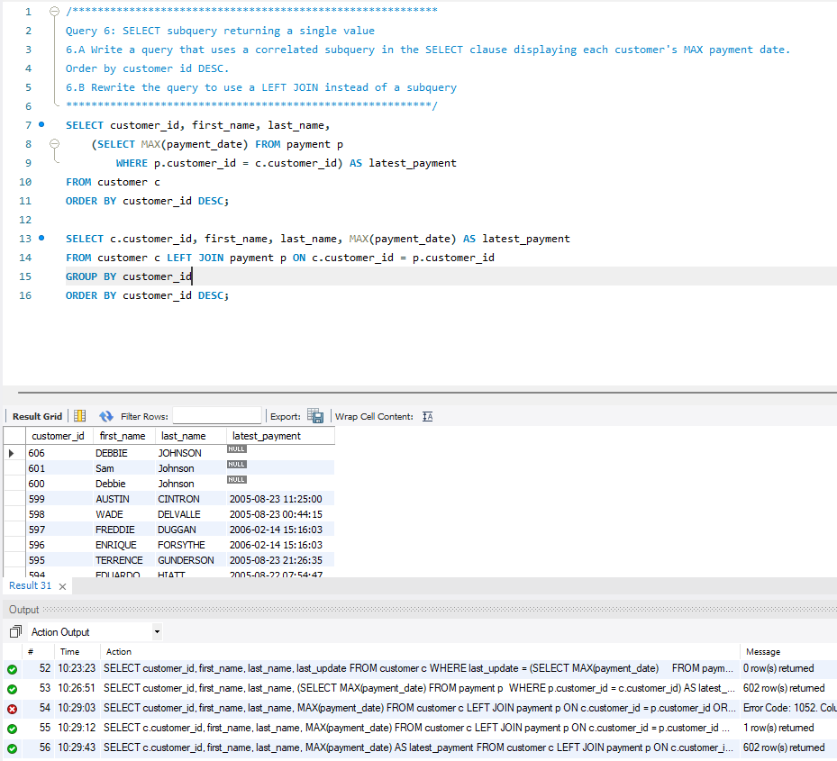
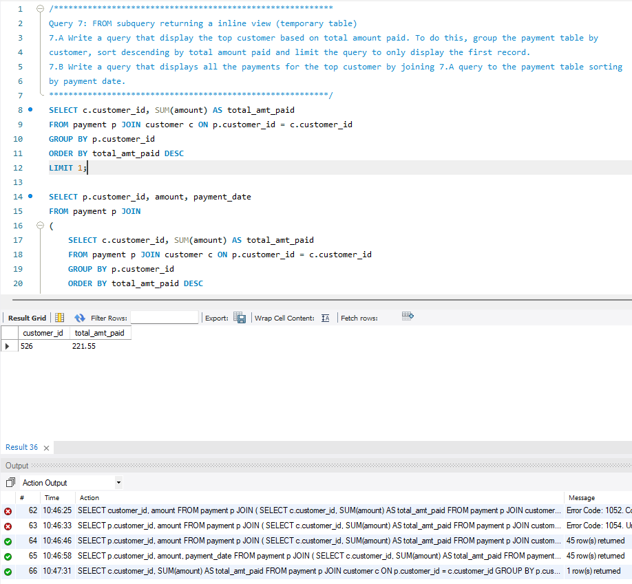
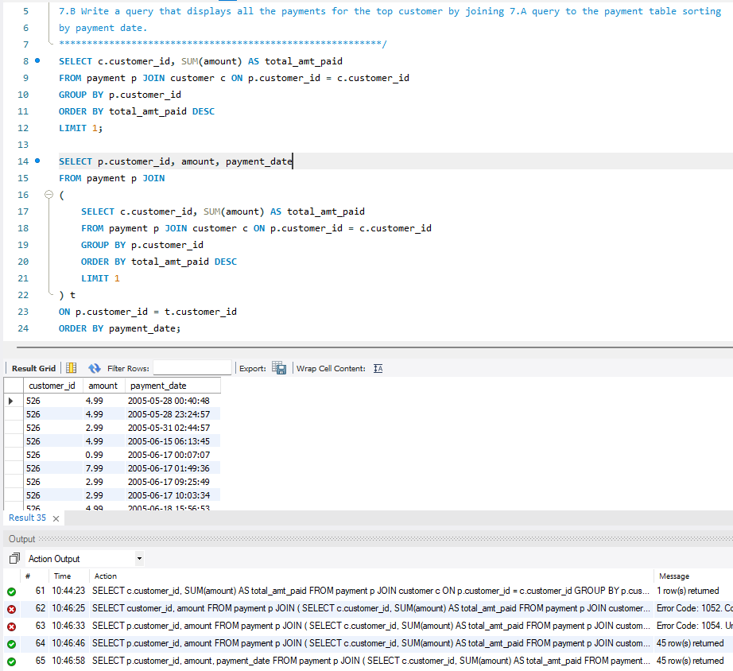

# MySQL_Chapter7

<b>Table of Content</b>
- [Summary](#summary)
- [Workers](#workers)
- [New Concepts Used](#new-concepts-used)
- [Browser Output Example](#browser-output-example)
  - [Query 1 Output](#query-1)
  - [Query 2 Output](#query-2)
  - [Query 3 Output](#query-3)
  - [Query 4 Output](#query-4)
  - [Query 5 Output](#query-5)
  - [Query 6 Output](#query-6)
  - [Query 7 Output](#query-7)
  - [Query 8 Output](#query-8)

## Summary
This is a list of queries being used to teach subqueries.
Some of them are rewrites, and others are completely new subqueries for a student.
All have a corresponding screenshot to show the output. They also have a section describing the query before it is written.
The code is all in the Code folder.

## Workers
[@28cyager](https://github.com/28cyager) Christian Yager

## New Concepts Used
- Subqueries
- ALL
- WHERE EXISTS

## Browser Output Example
## Query 1

## Query 2

## Query 3

## Query 4

## Query 5

## Query 6

## Query 7

## Query 8

[Back to Top](#single-query)
# Chapter7_Subqueries
